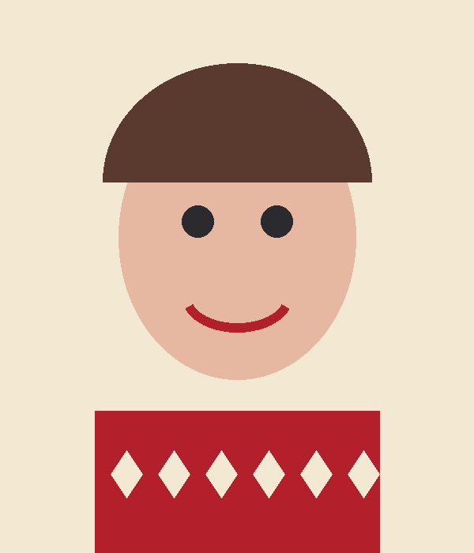
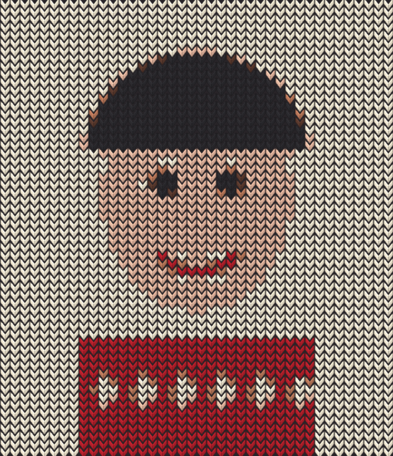
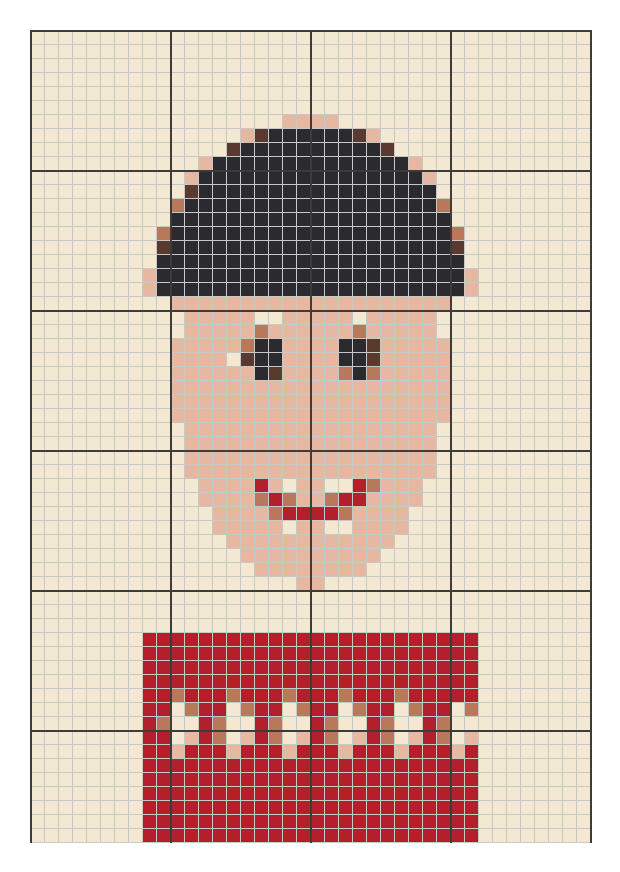

# ♾️🧶 The Infinite Ugly Sweater

An ugly holiday sweater with a knitted portrait of me on it… wearing the ugly sweater… wearing the ugly sweater… forever.
And a holiday card where I'm standing in a living room where **everything is knitted**, and the photo on the mantel is the card itself.

My entry for **Deck the Pixels 2026** (Google × Adobe): design an ugly sweater with Nano Banana in Photoshop, add yourself, and turn it into a holiday card.

| | |
|---|---|
| 🧶 **Concept** | [docs/CONCEPT.md](docs/CONCEPT.md): the idea, why it fits the judging criteria, the palette, and the ugliness checklist |
| 🪄 **Playbook** | [docs/PLAYBOOK.md](docs/PLAYBOOK.md): step-by-step Photoshop + Nano Banana process, planned around 5 free generations a day, plus the layer structure for the required screenshot |
| 💬 **Prompts** | [prompts/sweater.md](prompts/sweater.md) and [prompts/card.md](prompts/card.md): every Nano Banana prompt, in order, with checks and fixes |
| 🧵 **Photo → knitting tool** | [tools/knit_chart.py](tools/knit_chart.py): turns a photo into knitted intarsia and a knitting chart, used as a reference image so the portrait looks like real knitting |
| 📝 **Submission** | [SUBMISSION.md](SUBMISSION.md): written answers for Devpost |

## The photo → knitting tool

```bash
pip install pillow
python3 tools/knit_chart.py me.jpg --stitches 48 --palette portrait
# → me_knit.png (knitted look) and me_chart.png (a printable knitting chart)
```

| Input | Knitted (reference for Nano Banana) | Knitting chart |
|---|---|---|
|  |  |  |

Every stitch is drawn as the two slanted loops of a real stockinette "V", with shading and a little blur for wool fuzz, using only the sweater's yarn colours.

## Final images
_Coming soon: `sweater.png`, `card.png` and the Layers screenshot will go in `final/`._

Made with Adobe Photoshop and Google's Nano Banana. The script and docs are MIT licensed.
